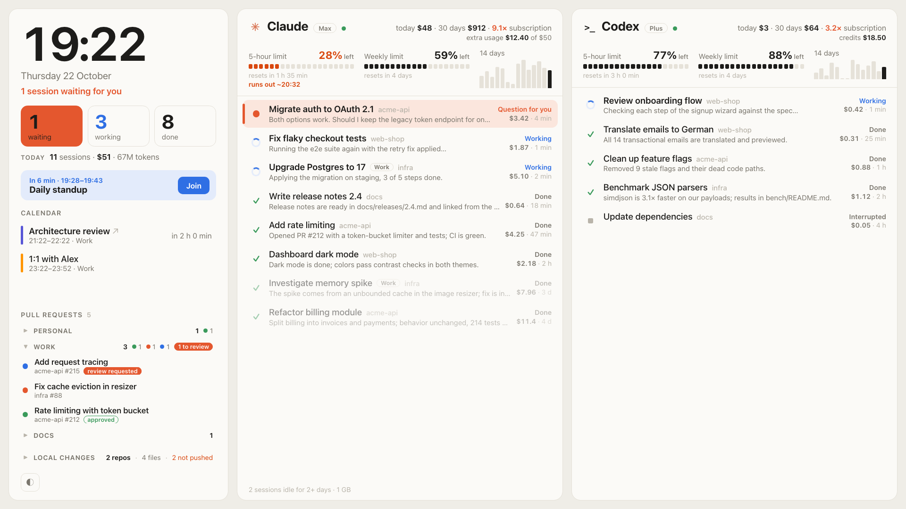

# AI Panel

**English** · [Polski](README.pl.md)

A desk dashboard for a second monitor that shows your **Claude Code** and **Codex** sessions at a glance:
which ones are waiting for you, usage limits with a forecast, per-chat cost, your next meeting,
open pull requests with CI status, and service status.



<sub>Screenshot uses made-up demo data (`AI_PANEL_DEMO=1`).</sub>

## Features

- **Sessions in two columns (Claude, Codex)**: waiting for you, working, done. Sessions that wait for
  you are highlighted and counted on the left. Click a session to open it in the app.
- **Usage limits**: how much is left of the 5-hour and weekly limits, with reset time, a forecast when the current pace would
  run out before the reset, and a banner when a limit is exhausted.
- **Cost**: today, last 30 days, multiple of your subscription, and an approximate per-chat cost at
  API prices. A 14-day token trend in each column header. Money you actually pay on top of the
  subscription (Claude extra usage, Codex credits) is shown separately.
- **Idle sessions**: Claude sessions idle for 2+ days are dimmed, with their count and memory use.
- **Local changes**: repositories of active sessions with uncommitted files or unpushed commits.
- **Calendar**: upcoming meetings from macOS Calendar, with a "Join" bar 10 minutes before a meeting
  (Teams, Meet, Zoom, Webex links).
- **Pull requests**: your open PRs and PRs waiting for your review, with CI status, from GitHub and
  GitLab, optionally split into groups.
- **Service status**: Anthropic and OpenAI status pages, shown as a dot next to each column title.
- **Kiosk window**: a small native WebKit window (about 180 MB instead of a full browser) that covers
  a chosen monitor, including its menu bar, appears when the monitor is connected and goes away when
  it is unplugged.
- Light and dark theme; scales to any resolution (designed for 1920×1080 and 1920×720 bar displays).
- Follows the system language (English and Polish so far; add a dictionary in `static/i18n.js` for more).
  Force one with `?lang=pl` in the URL or `PANEL_LANG="pl"` in `kiosk.conf`.

## Requirements

- macOS 14 or later (EventKit calendar access, launchd)
- Python 3.9+ (the system `python3` is fine; no dependencies)
- [Claude Code](https://claude.com/claude-code) and/or Codex (app or CLI)
- [OpenUsage](https://github.com/robinebers/openusage) running, for limits, costs and pricing
- Optional: [GitHub CLI](https://cli.github.com) (`gh auth login`) for pull requests
- Xcode Command Line Tools (`swiftc`) to build the calendar helper

## Install

```bash
git clone https://github.com/8itflip/ai-panel.git
cd ai-panel
./install.sh
```

This builds the calendar helper and installs three launchd agents: the server on
`http://127.0.0.1:7319`, the calendar exporter, and the kiosk window. macOS asks once for
Calendar access.

To pick the monitor for the kiosk window, create `kiosk.conf` with the display name from
System Settings → Displays:

```bash
SCREEN_NAME="M14"
```

Without it, the first display wider than 2:1 is used. The main display is never used.
Add `PANEL_LANG="en"` (or `"pl"`) to force the interface language.

### Pull request groups

Copy `config.example.json` to `config.json` (kept out of git) to split pull requests into groups,
for example personal and work. A group takes GitHub owners (users or orgs) and/or a GitLab host;
GitLab merge requests need [glab](https://gitlab.com/gitlab-org/cli) signed in with
`glab auth login --hostname <host>`. PRs from other GitHub owners land in "Other".
Restart the server after changing the file.

`./uninstall.sh` removes the agents. Logs are in `~/Library/Logs/ai-panel/`.

## Privacy

Everything runs locally. The server reads local files (Claude Code sessions in `~/.claude`, the Codex
database in `~/.codex`, the calendar export) and the OpenUsage API on localhost. The only network
requests are the public Anthropic/OpenAI status pages and the GitHub API through `gh`. Nothing from
your machine is sent anywhere.

The server listens on `127.0.0.1` only, rejects requests with a foreign `Host` header (DNS
rebinding), and only opens links that come from its own data, never a URL supplied by the page.

## Development

```bash
python3 server.py                  # real data
AI_PANEL_DEMO=1 python3 server.py  # demo data for screenshots
```

The page reloads itself when files in `static/` change.

## License

[MIT](LICENSE)
