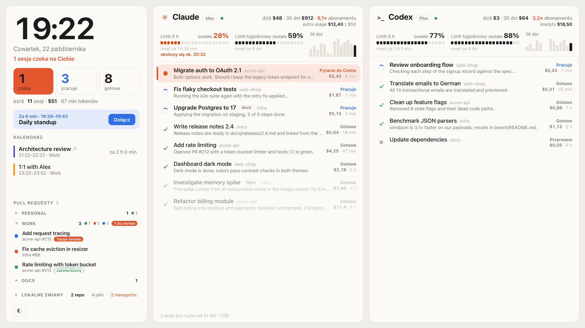

# AI Panel

[English](README.md) · **Polski**

Dashboard na dodatkowy monitor (np. 1920×1080 albo podłużny 1920×720): sesje Claude Code i Codex, limity, koszty i najbliższe spotkania.
Interfejs jest w języku systemu (polski lub angielski).


Działa w całości lokalnie, bez zależności (Python 3 ze standardową biblioteką + mały helper w Swift).

## Źródła danych

| Co | Skąd |
|---|---|
| Sesje Claude Code (desktop i CLI) | `~/.claude/sessions/<pid>.json` (status na żywo) + transkrypty w `~/.claude/projects/` |
| Wątki Codex (aplikacja i CLI) | `~/.codex/state_*.sqlite` (tabela `threads`) + pliki `rollout-*.jsonl` |
| Limity 5 h / tygodniowe, koszty | API OpenUsage: `http://127.0.0.1:6736/v1/usage` |
| Limity kolejnych kont Claude | API OpenUsage (j.w.): providery `claude@…`, które OpenUsage tworzy dla kont z Claude Swap |
| Kalendarz | aplikacja Kalendarz (EventKit) → `bin/calendar-helper` → `~/Library/Caches/ai-panel/calendar.json` |
| Trend 14 dni, koszt i tokeny dziś | API OpenUsage (j.w.) |
| Prognoza limitu | historia odczytów OpenUsage w `~/Library/Caches/ai-panel/usage-history.json` (tempo z ostatnich 45 min / 24 h) |
| Lokalne zmiany | `git status` (bez blokady indeksu) w repozytoriach aktywnych sesji, co minutę |
| Pull requesty i CI | `gh api graphql` co 2 min: Twoje otwarte PR-y + PR-y czekające na Twoje review |
| Status usług | publiczne `status.claude.com` i `status.openai.com` (`/api/v2/summary.json`) co 2 min |

Kliknięcie: sesja → aplikacja Claude/Codex (właściwa instancja, także z Parall), PR → przeglądarka,
spotkanie z linkiem → Teams/Meet. Klient podaje tylko, co otworzyć; adres zawsze pochodzi z danych serwera.

Statusy:
- **Czeka na Ciebie**: Claude zgłasza `waitingFor` (zgoda, pytanie), albo ostatnia odpowiedź agenta kończy się pytajnikiem („Pytanie do Ciebie”).
- **Pracuje**: Claude `status: busy`; Codex: ostatnie zdarzenie to `task_started`.
- **Gotowe** / **Przerwane**: tura zakończona / przerwana.

Claude Code i Codex zapisują sesje w nieudokumentowanych formatach. Gdy po aktualizacji dane przestaną
pasować (brak pól, kolumn w bazie albo znanych zdarzeń), kolumna pokazuje „zmienił się format danych”
ze szczegółem, zamiast po cichu zostać pusta.

„Aktywne” sesje to te z ruchem w ciągu ostatnich 24 h (`CLAUDE_ACTIVE_HOURS` i `CODEX_ACTIVE_HOURS`
w `server.py`). Aplikacja Claude usypia bezczynne sesje po ok. 30 minutach; panel pokazuje je dalej
(lista z `~/Library/Application Support/Claude/claude-code-sessions`), a kliknięcie je budzi.

## Uruchomienie

```bash
./install.sh     # usługi launchd: serwer :7319, helper kalendarza i okno kiosku
./uninstall.sh   # usuwa usługi
```

Okno kiosku (`bin/AI Panel Kiosk.app`, mały program z WebKitem, ok. 180 MB zamiast całej przeglądarki)
startuje przy logowaniu, pojawia się po podłączeniu monitora panelu i znika po jego odłączeniu.
Zakrywa cały ekran, łącznie z paskiem menu. Główny ekran nigdy nie jest brany.

Który monitor — w lokalnym pliku `kiosk.conf` (poza gitem), nazwa jak w Ustawieniach → Wyświetlacze:

```bash
SCREEN_NAME="M14"
PANEL_LANG="pl"   # opcjonalnie: wymusza język panelu (domyślnie język systemu)
```

Bez `kiosk.conf` wybierany jest pierwszy podłużny ekran (proporcje > 2:1). Układ skaluje się
do dowolnej rozdzielczości; projektowany pod 1920×720 i 1920×1080.

Grupy PR-ów: skopiuj `config.example.json` do `config.json` (plik lokalny, poza gitem). Grupa to
właściciele na GitHubie (konto lub organizacja) i/lub host GitLaba. Merge requesty z GitLaba wymagają
zalogowanego `glab`: `glab auth login --hostname <host>`. PR-y innych właścicieli trafiają do „Inne”.
Po zmianie pliku zrestartuj serwer.

Testy (bez zależności; test interfejsu używa Chrome bez okna, jeśli jest zainstalowany):
`python3 -m unittest discover -s tests` i `node --test tests/i18n.test.mjs`. GitHub Actions uruchamia je
przy każdym pushu.

Restart okna kiosku albo serwera (np. po zmianie `kiosk.conf`):
`launchctl kickstart -k gui/$UID/local.ai-panel.kiosk` i `launchctl kickstart -k gui/$UID/local.ai-panel.server`.

Do pracy nad wyglądem: `python3 server.py` i http://127.0.0.1:7319. Logi: `~/Library/Logs/ai-panel/`.
